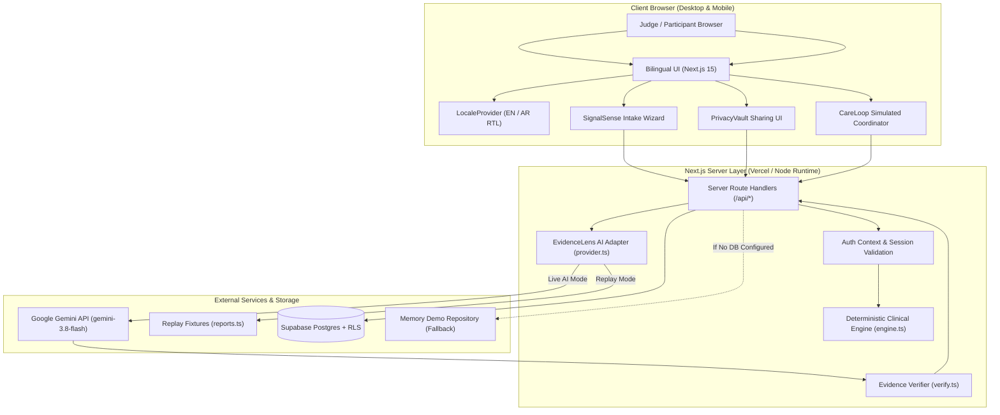

# VitaSignal AI — Technical Architecture

## System Architecture

## Security & Trust Boundaries

1. **Untrusted Client:** All user inputs pass through strict Zod schemas on the server. Client-side state transitions or role assignments are never trusted.
2. **Safety Override Gate:** Priority 1 and 2 rules are independently calculated by the backend before any AI calls or care sharing.
3. **Data Minimization:** No PII is collected. Sessions expire within 24 hours.
4. **Verbatim Grounding:** Evidence quotes from synthetic lab reports must match allowlisted fixture text verbatim before user confirmation.
